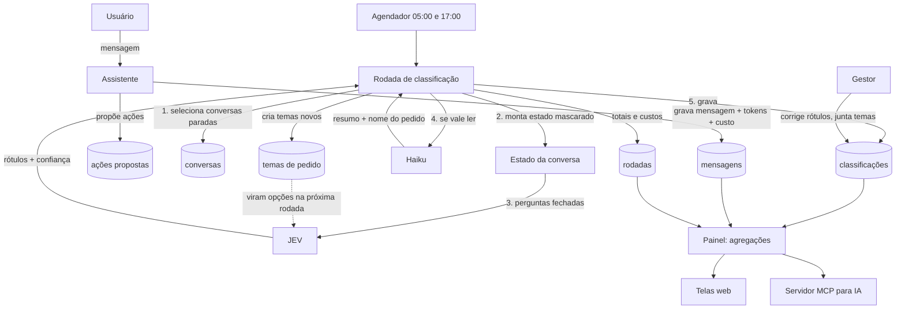
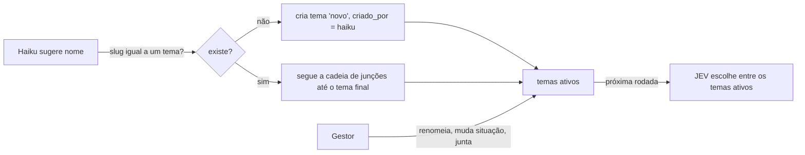

# Mapa do painel de uso da IA — guia para reimplementar em outro sistema

Este documento descreve, de forma independente de linguagem e framework, como funciona o painel de gestão do PequenaVia (`/gestao`): como o uso do assistente de IA é registrado, como cada conversa é classificada por dois modelos (JEV e Haiku), como os números e custos são calculados e o que aprendemos com a primeira versão.

O objetivo é servir de mapa para construir algo semelhante em outro sistema, com outro assistente e outro caso de uso. Cada seção separa **o que é genérico** (vale para qualquer assistente) do **que é específico do PequenaVia** (precisa ser trocado). A seção 12 reúne o que adaptar, e a 13 propõe uma ordem de implementação.

> Referência no código original: `app/Services/Gestao/*`, `config/gestao.php`, `app/Console/Commands/GestaoClassificar.php`, `resources/js/pages/gestao/*`, `resources/mcp/manual-da-gestao.md`.

---

## Sumário

1. [Visão geral](#1-visão-geral)
2. [Arquitetura e fluxo](#2-arquitetura-e-fluxo)
3. [Modelo de dados](#3-modelo-de-dados)
4. [Captura de uso e custo no assistente](#4-captura-de-uso-e-custo-no-assistente)
5. [A rodada de classificação](#5-a-rodada-de-classificação)
6. [JEV: perguntas fechadas](#6-jev-perguntas-fechadas)
7. [Haiku: resumo e nome do pedido](#7-haiku-resumo-e-nome-do-pedido)
8. [Temas de pedido](#8-temas-de-pedido)
9. [Métricas e fórmulas do painel](#9-métricas-e-fórmulas-do-painel)
10. [Telas, correções e acesso por MCP](#10-telas-correções-e-acesso-por-mcp)
11. [Privacidade](#11-privacidade)
12. [O que adaptar para outro caso de uso](#12-o-que-adaptar-para-outro-caso-de-uso)
13. [Ordem de implementação sugerida](#13-ordem-de-implementação-sugerida)
14. [Armadilhas da primeira versão e como evitá-las](#14-armadilhas-da-primeira-versão-e-como-evitá-las)
15. [Parâmetros de referência](#15-parâmetros-de-referência)

---

## 1. Visão geral

O painel responde a três perguntas do gestor do produto:

1. **Os clientes estão usando?** Quem está ativo, quem parou e até onde cada um configurou o sistema.
2. **O assistente está resolvendo?** Para que as pessoas usam o assistente, quanto resolve, onde frustra e onde erra.
3. **O que falta construir?** Pedidos que o produto ainda não atende, agrupados em temas e contados por cliente.

E mostra **quanto tudo isso custa**.

Três modelos de linguagem participam, todos chamados pelo OpenRouter:

| Papel | Modelo no PequenaVia | Quando roda | Custo |
|---|---|---|---|
| **Assistente** (o produto) | Haiku 5.5 (`ASSISTENTE_MODELO`) | A cada mensagem do usuário | Real, informado pelo provedor em cada resposta |
| **Classificador** | JEV (TypeSafe System One, `~typesafe/jev-latest`) | Em **todas** as conversas, em rodadas agendadas | Calculado: tokens de entrada × preço fixo |
| **Resumidor** | Haiku (o mesmo modelo do assistente) | **Só** nas conversas que valem leitura | Real, informado pelo provedor |

A ideia central: **um modelo barato e estruturado (JEV) lê tudo e dá rótulos com confiança; um modelo de texto (Haiku) só entra quando há algo a explicar.** Assim a classificação fica barata e os números do painel saem de rótulos fechados, não de texto livre.

---

## 2. Arquitetura e fluxo



Componentes (nomes do PequenaVia entre parênteses):

| Componente | Responsabilidade |
|---|---|
| Comando agendado (`gestao:classificar`) | Dispara uma rodada; agendado duas vezes por dia, sem sobreposição |
| Classificador (`ClassificadorDeConversas`) | Orquestra a rodada: seleção, JEV, Haiku, temas, gravação |
| Montador de estado (`EstadoDaConversa`) | Transforma a conversa no JSON que os modelos leem |
| Mascarador (`Mascarador`) | Tira dados pessoais antes de o texto sair do sistema |
| Perguntas (`PerguntasDoJev`) | **Único lugar** com os textos, as opções e os limiares das perguntas |
| Cliente JEV (`ClienteJev`) + resposta (`RespostaDoJev`) | Chamada HTTP com retentativas e leitura tolerante da resposta |
| Cliente de resumo (`ClienteDeResumo`) | Chamada ao Haiku em modo JSON |
| Painel (`PainelDeGestao`) | Todas as consultas e agregações (visão geral, clientes, cliente) |
| Conversas (`ConversasDaGestao`) | Lista filtrada, matriz caso × resultado, detalhe da conversa |
| Temas (`TemasDaGestao`) | Lista de temas, exemplos, junção |
| Escopo (`EscopoDaGestao`) | Decide quais contas entram nos números (só clientes, ou também as de teste) |

---

## 3. Modelo de dados

### 3.1 Campos de uso nas mensagens do assistente (genérico)

Cada resposta do assistente guarda o uso **somado de todas as rodadas de ferramenta** daquele pedido:

| Campo | Tipo | Origem |
|---|---|---|
| `tokens_entrada` | int, nulo | `usage.prompt_tokens` |
| `tokens_saida` | int, nulo | `usage.completion_tokens` |
| `tokens_do_cache` | int, nulo | `usage.prompt_tokens_details.cached_tokens` |
| `custo` | decimal(12,6), nulo | `usage.cost` (dólares, já com desconto de cache). Nulo = o provedor não informou |
| `erro` | bool | A resposta é uma mensagem de falha |
| `chamadas` | json | Ferramentas chamadas (nome, argumentos), para contar o uso de ferramentas |

### 3.2 `classificacoes` (uma por conversa; genérico)

| Campo | Tipo | Significado |
|---|---|---|
| `conversa_id` | uuid, único | Conversa classificada |
| `user_id` | uuid | Cliente dono da conversa (desnormalizado para agregar rápido) |
| `rodada_id` | uuid, nulo | Rodada que gravou esta leitura |
| `mensagens_ate` | timestamp | Até qual mensagem a leitura vale (= `ultima_mensagem_em` no momento) |
| `caso_de_uso` + `caso_confianca` | string + float | Rótulo do JEV |
| `resultado` + `resultado_confianca` | string + float | `resolvida`, `parcial`, `nao_resolvida`, `aguardando` |
| `abandonada` | bool | Parou esperando o usuário, que não voltou no prazo |
| `frustracao` + `frustracao_confianca` | float 0–3 + float | Nota do JEV |
| `confusa`, `pedido_fora`, `erro_do_assistente` | float 0–1 | Respostas sim/não (0,5 ou mais = sim) |
| `tema_id`, `tema_origem`, `tema_confianca` | uuid, `jev`/`haiku`, float | Pedido não atendido |
| `a_revisar` | bool | Confiança baixa: precisa de olho humano |
| `resumo` | texto, nulo | Do Haiku, quando rodou |
| `ferramentas` | json | Ferramentas que o assistente usou na conversa |
| `acoes_propostas`, `acoes_confirmadas` | int | Contagens no momento da leitura |
| `mensagens` | int | Total de mensagens |
| `tokens_assistente_entrada/saida` | int | Soma dos tokens do assistente na conversa |
| `modelo_jev` | string | Versão do classificador que respondeu |
| `correcao` | json, nulo | **Correção manual do gestor**, campo à parte (ver 10.2) |
| `classificada_em` | timestamp | Quando a leitura foi gravada |

Índices: `user_id`, `(caso_de_uso, resultado)`, `classificada_em`.

### 3.3 `rodadas` (uma por execução; genérico)

`iniciada_em`, `terminada_em`, `conversas_lidas`, `resumidas`, `temas_novos`, `falhas`, `tokens_jev`, `custo_jev` (decimal 10,6), `custo_haiku` (decimal 10,6), `erro` (texto).

### 3.4 `temas_de_pedido` (genérico)

`nome` (único, até 80), `descricao` (até 300), `situacao` (`novo` | `acompanhando` | `planejado` | `descartado`), `criado_por` (`haiku` | `gestor`), `juntado_em_id` (aponta para o tema que absorveu este).

### 3.5 `acessos_a_conversa` (auditoria; genérico)

`user_id` do gestor, `conversa_id`, `created_at`. Gravado **toda vez** que alguém abre o texto de uma conversa.

### 3.6 Conta de gestão

Campo `users.admin` (não editável por formulário). Controla o acesso ao painel e separa as contas de teste das contas de clientes.

---

## 4. Captura de uso e custo no assistente

Genérico, vale para qualquer assistente com ferramentas:

1. Peça o uso ao provedor. No OpenRouter, com streaming, o último pedaço do stream traz `usage` (inclusive `cost`).
2. Um pedido do usuário pode gerar várias rodadas modelo → ferramenta → modelo. **Some o uso de todas as rodadas** e grave o total na mensagem final do assistente.
3. O custo fica **nulo** enquanto o provedor não informar nenhum valor. Isso é diferente de zero e permite estimar depois.
4. Em caso de falha no meio do ciclo, **grave o uso já acumulado** mesmo sem texto visível (ver armadilha 14.5).
5. Para respostas antigas sem custo, estime: `(entrada × preço_entrada + saída × preço_saída) / 1.000.000`, com os preços em configuração. Desconte os tokens do cache se o modelo tiver preço de cache.

Com cache de prompt (modelos da Anthropic no OpenRouter), o PequenaVia marca `cache_control` no fim das instruções e na última mensagem, e anda a janela de histórico em blocos de 15 mensagens para o começo do contexto não mudar a cada pedido. Isso não é obrigatório para o painel, mas reduz bastante o custo que ele mostra.

---

## 5. A rodada de classificação

### 5.1 Agendamento

Duas rodadas por dia (05:00 e 17:00, no fuso do negócio), sem sobreposição. O painel mostra a última rodada e o horário da próxima.

### 5.2 Seleção das conversas candidatas

Uma conversa entra na rodada quando **todas** estas condições valem:

- está parada há pelo menos `ociosidade_minutos` (60). Não se classifica conversa em andamento;
- **e** uma destas:
  - nunca foi classificada;
  - recebeu mensagens depois da última leitura (`classificacao.mensagens_ate < conversa.ultima_mensagem_em`);
  - está `aguardando` há mais de `dias_aguardando` (3) e o gestor não corrigiu o resultado. Precisa ser fechada como abandonada;
- tem pelo menos uma mensagem do usuário;
- limite de `max_conversas_por_rodada` (500), das mais antigas para as mais novas.

### 5.3 Passos por conversa

```
para cada candidata:
    estado     = montar_estado(conversa)               # mascarado, ver 6.1
    perguntas  = montar_perguntas(temas_ativos)        # ver 6.2
    resposta   = jev.perguntar(estado, perguntas)      # ver 6.3
    rodada.tokens_jev += resposta.tokens_entrada

    caso, resultado = rótulos com confiança (opção inválida → padrão com confiança 0)
    aplicar regras de pós-processamento                # ver 6.4
    tema = tema do JEV, se válido                      # ver 8

    se (resultado em aberto) ou (pedido fora) ou (a_revisar)
       e rodada.resumidas < max_resumos_por_rodada:
        r = haiku.resumir(mensagens mascaradas, nomes dos temas ativos)
        rodada.resumidas++ ; rodada.custo_haiku += r.custo
        se não há tema e houve pedido fora e r.nome: tema = achar_ou_criar(r.nome)

    gravar classificação (upsert por conversa_id) com contagens de ferramentas, ações, tokens

no fim: rodada.custo_jev = tokens_jev × preço_jev / 1e6 ; terminada_em = agora ; salvar
```

### 5.4 Tratamento de falhas

| Situação | Comportamento |
|---|---|
| JEV falha (timeout, 4xx/5xx, resposta sem `answers`) | Conta em `falhas`, registra o motivo (`chave`, `credito`, `limite`, `pedido`, `servidor`, `timeout`, `resposta`) e segue para a próxima conversa |
| **3 falhas seguidas do JEV** | O serviço está fora: a rodada para e grava `erro` |
| Haiku falha | A conversa é classificada mesmo assim, sem resumo. O Haiku não é pré-requisito |
| Erro inesperado numa conversa | Conta como falha, zera a sequência e segue |
| Erro inesperado na rodada | Grava `erro` genérico e salva o que tiver |

Retentativas do JEV: só em 408, 429 e 5xx, com espera de 500, 1000 e 2000 ms. O timeout é de 30 s.

---

## 6. JEV: perguntas fechadas

### 6.1 O estado enviado

```json
{
  "app": {
    "name": "PequenaVia",
    "purpose": "Helps a parish secretary manage spaces, equipment, groups, bookings and certificates through chat.",
    "capabilities": [
      "Look up the calendar and the availability of spaces",
      "Propose a booking (one date and one space per proposal)",
      "...",
      "Cannot: recurring booking in a single proposal",
      "Cannot: reports"
    ]
  },
  "conversation": [
    { "from": "secretary", "text": "...(mascarado)...", "tools_used": [] },
    { "from": "assistant", "text": "...", "tools_used": ["consultar_agenda"] }
  ],
  "proposed_actions": { "confirmed": 1, "discarded": 0, "pending": 0 }
}
```

Regras genéricas:

- Só mensagens do usuário e do assistente **com texto**. Resultados de ferramenta e mensagens só com chamadas ficam de fora.
- Só as últimas `max_mensagens_no_estado` (40), cada uma cortada em `max_caracteres_por_mensagem` (1.200).
- **Mascare antes de cortar**, para que um pedaço de dado pessoal não escape pelo corte.
- `capabilities` com as linhas "Cannot: ..." é o que permite ao JEV decidir se um pedido está fora do produto. **É a parte mais importante para adaptar.**
- `proposed_actions` dá ao JEV um fato objetivo: mudança confirmada é mudança feita. Ação expirada conta como descartada.

### 6.2 As perguntas

O formato do JEV é `{id: {type, instructions, criteria}}`. As instruções funcionam melhor em inglês, literais e específicas; o estado pode ficar em português.

| id | Tipo | Instrução (resumo) | Opções / critérios |
|---|---|---|---|
| `use_case` | choice | O que o usuário queria principalmente? | Um item por caso de uso do produto, mais `fora_do_escopo` e `outro` |
| `outcome` | choice | No fim, conseguiu o que pediu? Considere `proposed_actions.confirmed`. Julgue o pedido principal; pendências pequenas no fim não desfazem | `resolvida`, `parcial`, `nao_resolvida` |
| `frustration` | score | Quão frustrado está o usuário? | 4 níveis: calmo · neutro · frustrado mas educado (repete, reclama) · muito frustrado ou desiste |
| `confused` | noul | O usuário parece confuso com o que o assistente disse? | — |
| `unmet_request` | noul | Pediu algo que o produto não faz (ver `app.capabilities`)? | — |
| `assistant_error` | noul | O assistente afirmou algo falso, se contradisse ou inventou? | — |
| `ended_waiting` | noul | A conversa termina com o assistente esperando uma resposta que não veio? | — |
| `unmet_theme` | choice (só se houver temas ativos) | Qual destas necessidades não cobertas o usuário tinha? | `tema_<id>`: "nome: descrição" de cada tema ativo, mais `outro` e `nenhum` |

### 6.3 Contrato da API do JEV

Requisição: `POST {url}` com `Authorization: Bearer <chave>` e corpo `{"model", "state", "questions"}`.

Resposta:

```json
{
  "model": "~typesafe/jev-latest",
  "answers": {
    "use_case":      { "type": "choice", "choice": "reserva", "probabilities": { "reserva": 0.9, "outro": 0.1 }, "confidence": 0.9 },
    "frustration":   { "type": "score", "score": 0.4, "legend": "...", "probabilities": {}, "confidence": 0.8 },
    "unmet_request": { "type": "noul", "noul": 0.9 }
  },
  "usage": { "input_tokens": 500, "output_tokens": 9 }
}
```

- `noul` é a probabilidade de **sim** (0 a 1), sem `confidence`. 0,5 ou mais conta como sim.
- Preço: US$ 0,042 por milhão de tokens de **entrada**; a saída é grátis.
- Leitura tolerante: pergunta sem resposta devolve valores zerados (confiança 0), o que manda a conversa para revisão em vez de inventar um rótulo.

### 6.4 Pós-processamento (regras de negócio sobre os rótulos)

| Regra | Lógica |
|---|---|
| Opção inválida | Rótulo fora da lista vira o padrão (`outro` para caso, `parcial` para resultado) com **confiança 0** |
| `a_revisar` | `caso_confianca < 0,6` **ou** `resultado_confianca < 0,6` |
| Parou esperando | `ended_waiting ≥ 0,5` **e** resultado ≠ `resolvida` |
| → recente (última mensagem há menos de 3 dias) | resultado = `aguardando`, confiança = valor de `ended_waiting`; `a_revisar` passa a olhar só a confiança do caso |
| → antiga | mantém o resultado do JEV e marca `abandonada = true` |
| "Frustrada" | `frustracao ≥ 1,5` |
| Faixas de frustração na tela | abaixo de 0,75 calma · até 1,5 neutra · até 2,25 frustrada mas educada · acima muito frustrada |

`aguardando` existe porque, sem ele, toda conversa em que o assistente fez uma pergunta e o usuário ainda não respondeu contaria como fracasso. Ela fica **fora da taxa de resolvidas** até o usuário voltar ou o prazo vencer.

---

## 7. Haiku: resumo e nome do pedido

### 7.1 Quando chamar

Só quando **pelo menos uma** destas vale, e com teto de `max_resumos_por_rodada` (100):

- resultado `parcial` ou `nao_resolvida`;
- `pedido_fora ≥ 0,5`;
- `a_revisar`.

Conversas resolvidas e sem pedido não precisam de resumo. Esse filtro é o que mantém o custo baixo.

### 7.2 Prompt (system)

```text
Você lê uma conversa entre <usuário> e o assistente do app <produto> e responde somente com JSON, neste formato:
{"resumo": "<até 2 frases>", "pedido": null | {"nome": "<até 5 palavras, como um título>", "descricao": "<1 frase>"}}

- "resumo" diz o que <o usuário> queria e se conseguiu. Não cite nomes de pessoas.
- "pedido" só é preenchido se <o usuário> pediu algo que o app ou o assistente não faz. Caso contrário, null.
- Se o pedido for igual a um dos temas já conhecidos, repita o nome exato desse tema.
```

Mensagem do usuário: `Temas já conhecidos:\n- tema A\n- tema B\n\nConversa:\nSecretaria: ...\nAssistente: ...`, com as mesmas mensagens mascaradas do estado do JEV.

Parâmetros: `temperature: 0`, `response_format: {type: json_object}`, `usage: {include: true}` (para receber `usage.cost`), sem streaming.

### 7.3 Validação

- `resumo` precisa ser texto não vazio; se não for, a chamada conta como falha (`json`).
- `pedido.nome` vazio vira "sem pedido".
- Corte: nome em 80 caracteres e descrição em 300.

---

## 8. Temas de pedido

Os temas transformam pedidos em texto livre numa lista finita e contável de "o que falta construir". O ciclo:



Regras:

- **Temas ativos** = não descartados e não juntados. Só eles viram opções do JEV e do Haiku.
- **Tema pelo JEV** vale quando a opção é `tema_<id>` de um tema ativo, a confiança é 0,6 ou mais **e** `pedido_fora ≥ 0,5`. Nesse caso o Haiku não cria tema.
- **Tema pelo Haiku** só quando o JEV não deu tema válido e houve pedido fora. A comparação usa o slug do nome (sem acentos, caixa e pontuação).
- **Juntar** A em B, numa transação:
  1. as classificações com `tema_id = A` passam para B;
  2. as correções que apontam para A também passam para B;
  3. A fica `descartado` com `juntado_em_id = B`.
  Não há desfazer.
- Com o tempo o JEV passa a reconhecer os temas sozinho, e o Haiku cria cada vez menos temas novos. É um vocabulário que se estabiliza.

---

## 9. Métricas e fórmulas do painel

### 9.1 Princípios

1. **Valor efetivo**: todo número usa `COALESCE(correcao.campo, campo_do_jev)`. A correção do gestor vence, e o rótulo original nunca é apagado. Para o tema, a chave presente com nulo quer dizer "nenhum tema".
2. **Período**: 7, 30 ou 90 dias **contando hoje**, no fuso do negócio, em janelas semiabertas `[início, fim)` convertidas para UTC. "Anterior" é a janela de mesmo tamanho logo antes.
3. **Escopo**: por padrão, só contas de clientes (`admin = false`). Um interruptor na sessão (ou um parâmetro no MCP) inclui as contas de teste. **Todo** número precisa respeitar o mesmo escopo (ver 14.1).
4. **Fila de revisão é estado atual**: não depende do período.
5. **Amostras pequenas**: mostre contagens, não só porcentagens.

### 9.2 Cartões da visão geral

| Cartão | Fórmula | Data que define o período |
|---|---|---|
| Clientes ativos | Clientes com (mensagens do usuário + reservas/eventos do domínio) > 0 | data da mensagem / do evento |
| Total e novos | Clientes no escopo / criados no período | `users.created_at` |
| Conversas | Conversas criadas no período, com variação contra o anterior | `conversas.created_at` |
| Resolvidas % | `resolvidas / (classificadas − aguardando) × 100`, uma casa; parcial conta como não resolvida; nulo se o denominador for 0 | `classificada_em` |
| A revisar | `count(a_revisar = true)` | — |
| Ações confirmadas | confirmadas no período e `% = confirmadas / propostas` | `confirmada_em` / `created_at` |
| **Custo total** | assistente + JEV + Haiku | ver 9.3 |

### 9.3 Custos

```
custo_assistente = Σ mensagens.custo                                  (respostas com custo informado)
                 + Σ (entrada × p_entrada + saída × p_saída) / 1e6    (respostas sem custo, estimadas)
                 → nulo se não há custo informado nem preços configurados

custo_jev   = Σ rodadas.custo_jev   (rodadas iniciadas no período)
custo_haiku = Σ rodadas.custo_haiku (rodadas iniciadas no período)

custo_total = (custo_assistente ou 0) + custo_jev + custo_haiku
```

- O custo do assistente aparece também por cliente e por conversa.
- Na tela, valor positivo abaixo de 1 centavo aparece como `< US$ 0,01`, e nulo como `—`.
- Ordem de grandeza observada: classificar custou cerca de 1/10 do assistente (JEV ≈ US$ 0,00006 por conversa; Haiku ≈ 5 vezes o JEV por rodada).

### 9.4 Gráficos e listas

| Bloco | Cálculo |
|---|---|
| Por dia | Um item por dia do período (inclusive os zerados): `resolvidas`, `nao_resolvidas = total − resolvidas − aguardando`, `aguardando` |
| Casos de uso | `count` por caso efetivo, com %, do maior para o menor |
| Matriz caso × resultado | por caso: total, resolvida, parcial, não resolvida, aguardando, abandonada e tendência `(atual − anterior) / anterior × 100` (nula sem base) |
| Clientes | ordenados por atividade (mensagens + eventos), depois pelo último acesso, depois pelo nome; com configuração feita/total, eventos, conversas, % resolvidas e último acesso |
| Último acesso | o maior entre a última mensagem do usuário e o último evento do domínio |

### 9.5 Alertas (no máximo 5, nesta ordem de prioridade)

| Alerta | Nível | Condição |
|---|---|---|
| Erros do assistente | alto | erros ontem > 0 **e** > 2 × média diária do período |
| Cliente parado | alto | sem acesso há 14 dias ou mais **e** a última conversa terminou em aberto (parcial ou não resolvida) |
| Tema mais citado | alto se houver frustradas, senão médio | o tema ativo com mais conversas no período: conversas, clientes distintos, frustradas |
| Tema novo | médio | tema `novo` com 5 ou mais conversas nos últimos 7 dias |
| Fila de revisão | baixo | `a_revisar > 0` |

### 9.6 Situação de um cliente

- **Parado**: nunca usou, ou sem acesso há 14 dias ou mais.
- **Atenção**: mais de 25% das classificadas do período não foram resolvidas.
- **Bem**: nos demais casos.

Na página do cliente também aparecem:

- **Trava**: o tema com mais conversas em aberto, em todo o histórico do cliente.
- **Linha do tempo**: até 8 marcos, como conta criada, primeiro cadastro, primeira solicitação, cadastros confirmados pelo assistente (agrupados por dia) e as 5 conversas em aberto mais recentes.

### 9.7 Temas

Por tema ativo: conversas, clientes distintos e frustradas no período, mais as contagens dos últimos 7 dias e dos 7 anteriores. A tela mostra os 3 resumos mais recentes do tema como exemplos e é ordenada por conversas no período. **Para priorizar o que construir, use o número de clientes distintos, não de citações.**

---

## 10. Telas, correções e acesso por MCP

### 10.1 Telas

| Tela | Conteúdo |
|---|---|
| Visão geral | Seletor de período, 5 cartões, gráfico por dia, casos de uso, alertas, top 8 clientes |
| Conversas | Filtros (caso, resultado, cliente, frustrada, a revisar), matriz caso × resultado, lista de 25 por página e painel de detalhe |
| Detalhe da conversa | Rótulos com confiança (ocultada quando corrigido), frustração, marcas (confusa, erro, abandonada), tema com origem (`jev`, `haiku` ou `gestor`), resumo, ferramentas, ações, tokens, custo, versão do JEV, as últimas 60 mensagens mascaradas e o botão "Corrigir" |
| Clientes | Busca por nome ou e-mail, tabela completa |
| Cliente | Situação, configuração (passos), cadastros, eventos (pelo assistente × pelo formulário), assistente (conversas, % resolvidas, custo), casos com resultado, trava, linha do tempo, conversas recentes |
| Temas | Última rodada (lidas, resumidas, temas novos, falhas, custo do JEV e do Haiku), lista de temas, detalhe com exemplos, editar (nome, descrição, situação) e juntar |

### 10.2 Correção manual

- O gestor corrige `caso_de_uso`, `resultado` e/ou `tema_id`. Só os campos enviados entram.
- A correção é **mesclada** no JSON `correcao`; o rótulo do JEV fica intacto.
- Nulo em caso ou resultado volta ao valor do JEV; nulo em tema quer dizer "nenhum tema".
- Corrigir zera `a_revisar`.
- Correções que se repetem são sinal de que as perguntas do JEV precisam de ajuste.

### 10.3 Servidor MCP (opcional, muito útil)

As mesmas consultas são expostas como ferramentas MCP, protegidas por OAuth e pela mesma permissão de gestor. Assim um assistente de IA (Claude etc.) pode analisar o painel:

| Ferramenta | Tipo |
|---|---|
| `manual_da_gestao` | leitura: explica os campos e dá receitas de análise |
| `resumo_do_painel` | leitura: a visão geral |
| `listar_temas` (com `tema_id` opcional) | leitura |
| `listar_conversas`, `ver_conversa` | leitura; `ver_conversa` registra o acesso |
| `listar_clientes`, `ver_cliente` | leitura |
| `corrigir_classificacao`, `atualizar_tema`, `juntar_temas` | **escrita**: o manual manda propor e só executar depois que o gestor confirmar |

Todas aceitam `periodo` e `incluir_gestores`. O manual (`resources/mcp/manual-da-gestao.md`) vale ser replicado: ele faz a IA começar pelo resumo, priorizar temas por número de clientes e informar o tamanho da amostra.

---

## 11. Privacidade

- **Mascarador**, aplicado antes de qualquer texto sair para um modelo e antes de mostrar texto no painel:
  - e-mail → `[e-mail]`;
  - CPF, CNPJ e 14 dígitos → `[documento]`;
  - telefone brasileiro → `[telefone]`;
  - nomes conhecidos → `[nome]`: o nome do dono da conta e os nomes de grupos, cada palavra com 3 letras ou mais, como palavra inteira, ignorando caixa e acentos.
- Os **títulos** das conversas também passam pela máscara, porque nascem da primeira mensagem.
- **Auditoria**: cada abertura de conversa grava quem abriu e quando.
- O Haiku é instruído a não citar nomes no resumo.
- Adapte as listas de nomes e os padrões de documento ao novo domínio e ao país (seção 12).

---

## 12. O que adaptar para outro caso de uso

| Item | No PequenaVia | O que fazer no novo sistema |
|---|---|---|
| **Capacidades** (`app.capabilities`) | 9 "pode" + 5 "Cannot: ..." | Liste o que o assistente faz **e o que não faz**. É o que permite detectar pedidos fora do produto. Atualize sempre que o produto mudar |
| `app.purpose` | Secretaria paroquial gerencia espaços... | Uma frase sobre quem usa e para quê |
| **Casos de uso** | consultar agenda, reserva, solicitações, cadastro, certificados, dúvida sobre o app, fora do escopo, outro | 5 a 8 casos mutuamente exclusivos, com uma descrição de uma linha cada; mantenha `fora_do_escopo` e `outro` |
| Critério de "resolvida" | pergunta respondida ou mudanças confirmadas | Defina o que é sucesso no domínio. Se houver ações com confirmação, envie as contagens em `proposed_actions` |
| Perguntas noul | confusa, pedido fora, erro do assistente, terminou esperando | Mantenha as quatro (são genéricas) e acrescente as do domínio (ex.: "pediu para falar com humano?") |
| Escala de frustração | 4 níveis | Mantenha, a menos que o público peça outra régua |
| Papéis no estado | `secretary` / `assistant` | Troque o nome do usuário em todas as instruções |
| "Evento do domínio" para atividade | reservas | O que indica uso real do produto além do chat (pedidos, tickets, agendamentos) |
| Configuração do cliente | primeiros passos (feitos/total) | Seu onboarding, se houver |
| Linha do tempo | primeiro espaço, primeira solicitação, cadastros pelo assistente | Os marcos de ativação do novo produto |
| Mascarador | CPF, CNPJ, telefone BR, nomes do dono e dos grupos | Documentos e telefones do país; entidades com nomes próprios do domínio |
| Horários das rodadas, fuso | 05:00 e 17:00, São Paulo | Antes e depois do expediente dos usuários |
| Prazos | 60 min de ociosidade, 3 dias aguardando, 14 dias para "parado" | Ajuste ao ritmo de uso: um sistema de uso diário pede prazos menores |
| Idioma | instruções do JEV em inglês, prompt do Haiku e telas em português | Mantenha as instruções do JEV em inglês |

---

## 13. Ordem de implementação sugerida

1. **Uso e custo no assistente** (seção 4). Sem isso o painel não tem custo real. Comece a gravar já, mesmo antes do painel.
2. **Dados**: tabelas da seção 3 e a marca de conta de gestão.
3. **Mascarador e montador de estado**, com testes de unidade (nomes com acento, documentos, corte após a máscara).
4. **Perguntas e cliente do JEV**, com testes que simulam respostas (inválida, sem resposta, falhas HTTP).
5. **Classificador e comando agendado**: seleção, pós-processamento, falhas e totais da rodada.
6. **Haiku e temas**: chamada condicional, criação por slug, cadeia de junções.
7. **Consultas do painel** (seção 9), com testes de fronteira de período e fuso.
8. **Telas**: visão geral → conversas (com correção) → temas (com junção) → clientes.
9. **MCP + manual** para análise por IA.
10. **Ajuste fino**: rode por 2 a 4 semanas, revise a fila `a_revisar`, compare as correções com os rótulos e ajuste as perguntas e capacidades.

Teste com dados simulados (respostas falsas do JEV e do Haiku). Os testes do PequenaVia (`tests/Feature/Gestao/*`) mostram os formatos usados.

---

## 14. Armadilhas da primeira versão e como evitá-las

Encontradas ao auditar o PequenaVia. No sistema novo, já nasça com a correção.

1. **Custo da classificação fora do escopo.** No PequenaVia, o custo do JEV e do Haiku soma as rodadas inteiras, então inclui as conversas das contas de teste mesmo com o filtro "só clientes" (confirmado em produção: JEV e Haiku iguais nos dois modos, assistente diferente).
   *Faça*: grave o custo do JEV e do Haiku **por classificação** (colunas `custo_jev` e `custo_haiku` em `classificacoes`) e agregue com o mesmo filtro de escopo. Considere também não classificar as contas de teste, ou classificá-las à parte.
2. **Preço do classificador fixo no código.**
   *Faça*: preço em variável de ambiente; se o provedor devolver `cost`, use o valor real.
3. **"Conversas por dia" na verdade é "classificações por dia".** O gráfico, os casos e a taxa de resolvidas usam `classificada_em`, e a reclassificação sobrescreve essa data, então a conversa "muda de dia".
   *Faça*: escolha uma data de referência estável (início ou `mensagens_ate`) para os gráficos, ou nomeie o gráfico pelo que ele mostra. Use a mesma população no cartão "Conversas" e na taxa de resolvidas.
4. **A correção fica velha depois de uma reclassificação.** Mensagens novas geram uma leitura nova, mas a correção antiga continua valendo, e `a_revisar` é recalculado, então uma conversa corrigida pode voltar para a fila.
   *Faça*: guarde em `correcao` até qual `mensagens_ate` ela vale. Ao reclassificar com mensagens novas, descarte a correção (ou marque como "corrigida antes das mensagens novas") e não reabra a revisão de campos corrigidos.
5. **Custos que se perdem:**
   - resposta do Haiku cobrada mas com JSON inválido: some o custo antes de validar;
   - rodada interrompida no meio (timeout, deploy): só salva no fim. Salve os totais a cada N conversas, ou grave o custo por classificação (item 1);
   - assistente que falha depois de uma rodada de ferramenta, sem texto visível: o uso acumulado não é gravado. Grave sempre o uso, mesmo na mensagem de erro.
6. **Estimativa sem cache.** A estimativa de respostas antigas ignora `tokens_do_cache` e supervaloriza. Aplique o preço de cache quando houver.
7. **Documente a semântica do `noul`.** No código original um comentário diz que é a probabilidade de "não"; é de **sim**. Um mal-entendido aqui inverte metade das métricas.
8. **Confiança da frustração não é usada.** Ou inclua no critério de `a_revisar`, ou não grave.
9. **Tema descartado sem junção absorve conversas.** Quando o Haiku repete o nome de um tema descartado (não juntado), a conversa vai para ele e some das contagens. Decida de propósito: ignorar o tema, ou avisar o gestor de que um tema descartado voltou a aparecer.

---

## 15. Parâmetros de referência

| Parâmetro | Valor | Onde |
|---|---|---|
| Rodadas | 05:00 e 17:00, sem sobreposição | agendador |
| `ociosidade_minutos` | 60 | config |
| `max_conversas_por_rodada` | 500 | config |
| `max_resumos_por_rodada` | 100 | config |
| `max_mensagens_no_estado` | 40 | config |
| `max_caracteres_por_mensagem` | 1.200 | config |
| `confianca_minima` (`a_revisar`) | 0,6 | config |
| Confiança mínima do tema pelo JEV | 0,6 | código |
| Limiar do noul (sim) | 0,5 | código |
| Frustração alta | 1,5 (escala 0–3) | código |
| `dias_aguardando` | 3 | config |
| `dias_sem_acesso_alerta` | 14 | config |
| `tema_novo_alerta_semana` | 5 conversas em 7 dias | config |
| Atenção do cliente | mais de 25% não resolvidas | código |
| Alerta de erros | mais de 2 × a média diária | código |
| Falhas seguidas para parar a rodada | 3 | código |
| Retentativas do JEV | 500 / 1000 / 2000 ms em 408, 429 e 5xx; timeout de 30 s | código |
| Preço do JEV | US$ 0,042 por milhão de tokens de entrada | config (fixo) |
| Preço estimado do assistente | US$ 0,10 entrada / US$ 0,50 saída por milhão | env |
| Períodos | 7, 30, 90 dias (padrão 30) | código |
| Lista de conversas | 25 por página; detalhe com as últimas 60 mensagens | código |
| Alertas | no máximo 5 | código |
